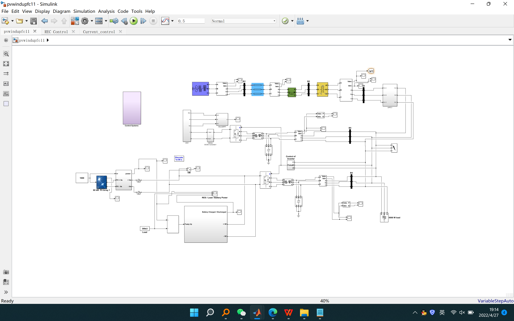

# Microgrid hybrid photovoltaic/wind energy/battery management system (simulation)

The focus is primarily on developing hybrid photovoltaic-wind power systems and battery storage systems for grid connection based on intelligent control. Matlab-based simulation models for grid-integrated hybrid photovoltaic-wind energy systems and battery management system (BMS) with intelligent controllers have been developed, and the system performance under normal conditions has been analyzed. The same system has also been simulated using UPFC and the system performance under different fault conditions has been analyzed.

## Images

<!-- PAYMENT_BLOCK -->

## Get this dataset

- Payment link (Stripe): [Buy now](https://buy.stripe.com/3cs8yP7sY87d0vu9AB)
- Payment QR code: 

<!-- /PAYMENT_BLOCK -->
